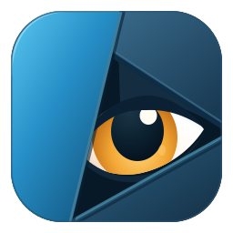

  

# Dzurkel 1.0.0 — Quick Look for Linux

**Peek-a-Dzurkel!**

Select a file, press **Space**, and preview it without opening a full application.

Images, PDFs, documents, spreadsheets, e-books, source code, audio and video—all
in one reusable, read-only window. Integrates with **Dolphin, Nautilus and Thunar**.
Enable Space previews in Dzurkel Settings after installation.

**[Download Dzurkel](https://github.com/EdinUser/dzurkel/releases) ·
[Installation](docs/installation.md) · [Supported formats](docs/previews.md)**

## Supported systems

| Support level | Fedora | Ubuntu | Arch Linux |
| --- | --- | --- | --- |
| **Minimum — core previews** | **37+**, with updates | **23.04+** (maintained LTS: **24.04+**) | Fully updated rolling system |
| **Full — desktop features** | **43+**, with updates (KDE) | **26.04 LTS+** (GNOME) | Fully updated rolling system, with optional dependencies |
| **Desktop tested** | **44**, KDE Plasma 6, Wayland | **26.04.1**, GNOME 50, Nautilus 50.2.2, Wayland | **2026-10-21**, XFCE 4.20, Thunar 4.20.10, X11 |

Minimum versions are **calculated source compatibility floors** for native
distribution libraries on x86_64/amd64. Full lists reviewed releases supplying
the feature dependencies for the named desktop, with optional packages installed;
it does not establish the earliest historical full-feature release. Desktop
testing is recorded separately. Historical core floors include releases that
have reached end of life; use a maintained release. Arch has no numbered release
floor and requires full system updates.

Folder sizing uses alternative adapters: GNOME/XFCE prefer GIO, while KDE prefers
KIO and can fall back to GIO. KIO 6.30+ is needed only for the native KDE
folder-size adapter; its absence does not make Ubuntu GNOME incomplete. Legacy
Word DOC needs optional `antiword`, and media playback needs suitable codecs.
Dolphin Space setup separately requires Dolphin 26.04+.

**Downloaded packages may require a newer OS.** Use the package built for your
distribution and release; a Debian DEB is not an Ubuntu compatibility promise.
See [runtime requirements](docs/runtime-baseline.md)
and [desktop testing and known limits](docs/testing.md). The tested row records
selected checks across development builds, not complete acceptance of every
1.0.0 release package.

*[Watch the full video](docs/video/dzurkel-demo-0.8.0.mp4): image → PDF → DOCX →
XLSX → video → source code, in one reusable preview window. Recorded alongside
Dolphin with synthetic files; the GIF plays at 1.25× speed. Appearance follows
your Qt theme. [Recording details](docs/video/README.md).*

[Watch Dzurkel 0.8.0 video demonstration on YouTube](https://youtu.be/jmBDK_8AFfQ)

## Features

- Browse neighboring files with the arrow keys in one preview window.
- Zoom images and PDFs, navigate PDF pages and switch spreadsheet sheets.
- Play audio and video, seek where supported, and share mute/volume choices.
- Read source code with optional syntax highlighting and remembered text wrapping.
- Scroll text, tables, documents and e-books with small initial loads and bounded resident content.
- Jump to the actual end of text/log/SQL files with **End** or Ctrl+End.
- Inspect folders with asynchronous desktop-backed contents size and file counts.
- Preview direct sources without whole-file temporary copies, including local files and mounted shares.
- Follow your desktop's Qt theme, with Wayland and X11 integration.

**Space/Escape** dismiss the preview; **P** toggles media playback. Audio and video
autoplay with sound unless muted. Dzurkel stays resident for reopening;
`dzurkel --quit` exits it fully. See [keyboard controls](docs/usage.md).

## Supported formats

| Content | Preview |
| --- | --- |
| Images | Common image formats and animated GIFs; zoom and natural size |
| PDF | Pages, navigation and zoom |
| Documents | DOCX, RTF and Markdown; legacy DOC as text with optional `antiword` |
| Spreadsheets | CSV/TSV and XLSX; sheet selection and saved formula results |
| E-books | EPUB, FB2, SFB and MOBI 6; readable content and basic formatting |
| Text and source code | Plain text, wrapping and optional syntax highlighting |
| Audio | Playback, seeking, volume/mute and available track metadata |
| Video | MP4/M4V, MKV, WebM, MOV, AVI, MPG/MPEG, OGV and WMV; aspect-preserving playback |
| Folders | Folder information, optional contents size and file/subfolder counts |
| Other files | File information for unsupported formats and symbolic links |

Media support depends on installed Qt backends and codecs. Audio-only containers
use the music view. See [supported formats and preview limits](docs/previews.md)
and [what's new in 1.0.0](docs/releases/v1.0.0.md).

## Installation

Download the installer matching your system from
[Releases](https://github.com/EdinUser/dzurkel/releases). Packages are attached
after release validation succeeds. **This checkout is version 1.0.0, prepared
for release.** A source version bump does not publish installers; check the
release listing for available downloads and the [1.0.0 notes](docs/releases/v1.0.0.md)
for validation and known limits.

| System | Package | Install the downloaded file |
| --- | --- | --- |
| Fedora 44, x86_64 | RPM | `sudo dnf install ./dzurkel-<version>-1.fc44.x86_64.rpm` |
| Debian 13, amd64 | DEB | `sudo apt install ./dzurkel_<version>-1_amd64.deb` |
| Current Arch Linux, x86_64 | Arch package | Update with `sudo pacman -Syu`, then `sudo pacman -U ./dzurkel-<version>-1-x86_64.pkg.tar.zst` |

Replace `<version>` with the downloaded version. Choose the runtime installer,
not a source or debug package. Packages are unsigned; verify the accompanying
checksums. Updates use the same download/install procedure; there is no Dzurkel
package repository. Quit the resident process before upgrading and restart afterward.

See the [installation, updates and removal guide](docs/installation.md) for
checksum commands, optional components and source builds. AppImage remains planned.

## File manager integration

Open **Dzurkel Settings** from the application menu or with `dzurkel --settings`.
Choose your file manager's **Enable Space shortcut** action. Installation alone
leaves shortcuts unchanged; Settings provides reversible setup.

| File manager | Setup and scope |
| --- | --- |
| **Dolphin** | Space setup needs **26.04+**; local and authenticated remote locations. A context-menu action is also available. [Setup and troubleshooting](docs/dolphin-integration.md) |
| **Nautilus (GNOME Files)** | Opt-in Space previews for local files and folders; file navigation follows the Files selection. [Setup, provider conflicts and validation](docs/gnome-testing.md) |
| **Thunar** | Space and **Preview with Dzurkel** for one local file or folder; mounted paths work as local paths. [Setup and restoration](docs/thunar-integration.md) |

Finish file operations before accepting a file-manager restart. Desktop focus
policies and validation differ; see compatibility below.

An optional adapter supports **KDE file-open and
upload dialogs**, separate from Dolphin's shortcut. Enable **Space previews in
KDE file dialogs** in Settings and sign out/in to load it into compatible Qt
applications. This requires a build containing a compatible adapter.
See [setup, scope and validation](docs/file-dialog-previews.md).

[Folder contents sizing](docs/folder-previews.md) uses
optional desktop libraries. Existing Thunar setups offer **Update folder previews…**
in Settings. See the [1.0.0 release notes](docs/releases/v1.0.0.md) for changes,
validation and known limits.

## Lightweight by design

Dzurkel focuses on inspecting files in a reusable window. File contents are never
edited or executed, and XLSX formulas are not recalculated. Complex document
formatting is simplified for readable previews; protected/encrypted content shows
an error. Progressive loading keeps only adjacent portions resident and reloads
earlier content when revisited. Later errors retain useful visible content.

Dzurkel is a quick previewer: distant replay or a very large indivisible document
construct can reach a work limit. SQL and other source files retain their selected
language, while highlighting may lose multiline comment/string context after
earlier text is evicted. See [preview limits](docs/previews.md).

The baseline application previews images, PDFs, text, tables, documents and
supported e-books. Media playback, syntax highlighting and desktop-specific
enhancements use optional, runtime-loaded adapters. Missing media support gives
an explanation; missing highlighting leaves plain text usable. Other baseline
previews remain available.

See [baseline and optional components](docs/runtime-baseline.md) for requirements
and recovery, and [preview limits and filesystem policy](docs/previews.md) for
direct-source lazy loading, incremental media reads and decoder limitations.

## Compatibility and limitations

Dzurkel is built with C++20 and Qt 6. Fedora KDE Wayland is the primary development
environment; file managers and desktops have different levels of validation.

The **source baseline** requires Qt 6.4+, Qt PDF/PDF Widgets 6.4+ and libzip 1.7+.
Debian 12 meets that baseline and has passed the headless build and staged-install
checks. The [supported systems table](#supported-systems) separates calculated
Fedora/Ubuntu dependency floors from desktop testing. A RHEL minimum has not been
established. Native package compatibility and desktop behavior require their
own validation.

**Downloaded packages can require a newer OS than the source baseline.** Each
build ships a `build-compatibility.json` report with its runtime requirements,
reviewed OS candidates and validated minimums where available. Open **Settings →
Integration → System requirements → OS compatibility…** to see the report for
your build. Use the release package matching your distribution and version.
See [runtime requirements and OS compatibility](docs/runtime-baseline.md) for details.

| Environment or location | Status |
| --- | --- |
| Dolphin 26.04+ | Target for Space shortcut integration |
| Other distributions or desktops | Not yet validated; source builds may work |
| Local files and mounted shares | Supported |
| Direct SMB URLs | Optional KIO-FUSE/KIO workers required; authenticate in Dolphin |
| Direct SFTP URLs | Experimental; enable explicitly in Settings |

See the [location compatibility guide](docs/compatibility.md) and
[testing report](docs/testing.md) for evidence and limitations. Qt 6.4 is the
configured minimum, not a promise of compatibility with every Qt/KDE release.

## Technical documentation

Start with the [documentation index](docs/README.md) for setup, preview behavior,
network access, architecture, testing and release guides.

- [Usage and keyboard controls](docs/usage.md)
- [Supported formats and limits](docs/previews.md)
- [Location compatibility and experimental SFTP](docs/compatibility.md)
- [Runtime requirements and OS compatibility](docs/runtime-baseline.md)
- [Testing evidence and remaining checks](docs/testing.md)

## Contributing

Dzurkel uses C++20 and Qt 6. See [CONTRIBUTING.md](CONTRIBUTING.md) for development
and reporting guidance, the [source installation guide](docs/installation.md#dependencies)
for dependencies, and [architecture](docs/architecture.md) for module boundaries.
Automated checks and native desktop acceptance are documented separately.

## Development

Dzurkel's implementation code is AI-generated. Project direction, requirements,
testing and release decisions are guided by the project maintainer. See
[contributing guidance](CONTRIBUTING.md) and the [testing record](docs/testing.md)
for how changes are checked.

## License

Dzurkel is licensed under **GPL-3.0-or-later**. See [LICENSE](LICENSE).
The name comes from “Дзъркел”, Bulgarian slang for “eye”.
