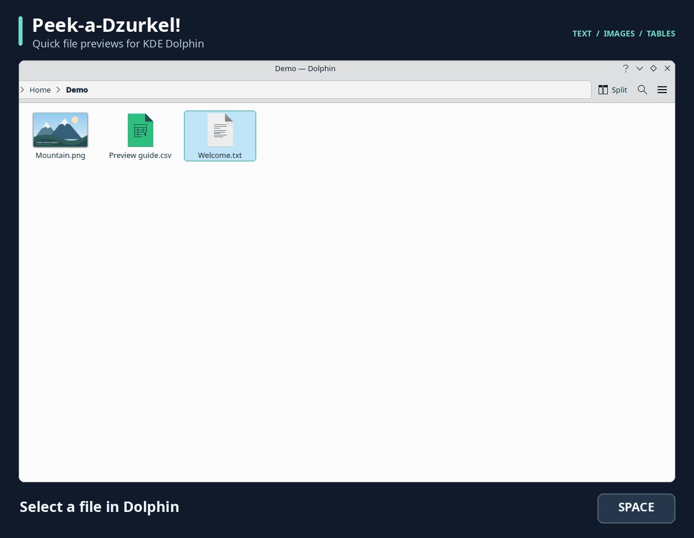

# Dzurkel — quick file previews for Linux

**Peek-a-Dzurkel!** Preview a file without opening a full application.
Dzurkel is a Qt 6 file previewer for Linux, built for Fedora, KDE Plasma and
Wayland. Use Dolphin’s context menu, or enable the **Space** shortcut to preview
selected files in a reusable window.

[](https://github.com/EdinUser/dzurkel/actions/workflows/ci.yml)
[](LICENSE)



*Preview demo using synthetic sample files; appearance follows your Qt theme.*

## What can I preview?

- **Images**, including animated GIFs, with zoom and natural-size display.
- **PDF documents**, with page navigation and zoom.
- **Music/audio**, with playback, seeking, volume/mute and available track metadata.
  Formats depend on the installed Qt media backend and codecs.
- **Plain text** and **CSV/TSV tables**.
- **XLSX spreadsheets**, with sheet selection and saved formula results.
- **File information** for unsupported formats, directories and symbolic links.

Use arrow keys to browse supported neighboring files. Press **Escape** or close
the window to dismiss a preview. Dzurkel stays resident for faster reopening;
`dzurkel --quit` exits it fully. Previewing never executes file contents or
modifies the source file. XLSX formulas are not recalculated.

See [supported formats and limits](docs/previews.md) and
[keyboard controls](docs/usage.md).

## Install on Fedora KDE

The initial packaging target is **Fedora 44, x86_64**. RPM automation is being
introduced; a successful CI build is not a certification of desktop behavior.

When a release RPM is available, download the `dzurkel` binary package matching
Fedora 44 from [Releases](https://github.com/EdinUser/dzurkel/releases), then:

```bash
sudo dnf install ./dzurkel-<version>-1.fc44.x86_64.rpm
```

Replace the filename with the downloaded package. Do not install the source RPM
or debug packages to run Dzurkel. For now, updates use the same download/install
procedure; there is no Dzurkel DNF repository.

To build and install the current checkout instead, follow the
[Fedora source installation guide](docs/installation.md#user-local-installation).
Debian 13 amd64 and current Arch Linux x86_64 packages are also built by CI.
See [Debian and Arch installation](docs/installation.md#debian-and-arch-packages)
for commands and limitations. AppImage remains planned.

## Enable Space previews in Dolphin

1. Open **Dzurkel Settings** from your application menu, or run `dzurkel --settings`.
2. Choose **Enable Space shortcut…** and review the shortcut changes.
3. Allow Dolphin to restart when prompted, then select a file and press Space.

Settings backs up affected bindings and offers **Restore previous shortcuts**.
Installation alone does not reassign keys. You can also right-click a file in
Dolphin and choose **Dzurkel**, then open **Settings** from the preview.

Shortcut integration targets **Dolphin 26.04 or newer**. See
[Dolphin setup and troubleshooting](docs/dolphin-integration.md) if the menu or
shortcut is unavailable. Window activation follows the desktop’s focus policy.

On GNOME with Nautilus (Files) installed, Settings shows **Nautilus shortcut**.
Choose **Enable Space shortcut**, then select a local file in Files and press
Space. Dzurkel starts automatically and navigation follows the selection in
Files. **Restore previous previews** restores the previous user preview provider.
If another provider such as Sushi is running, close its preview and quit it
before enabling Dzurkel. Setup does not change system packages or global keys.
See [GNOME and Nautilus testing](docs/gnome-testing.md) for scope and validation.

On XFCE with Thunar installed, Settings shows **Thunar shortcut**. Enable setup
there to add Space previews and **Preview with Dzurkel** to Thunar's context menu.
Finish file operations before allowing Thunar to restart. Setup is reversible
and preserves unrelated actions and shortcuts. See [Thunar integration](docs/thunar-integration.md).

## Compatibility

| Environment or location | Status |
| --- | --- |
| Fedora 44, KDE Plasma 6, Wayland | Primary development and desktop validation environment |
| Dolphin 26.04+ | Target for Space shortcut integration |
| Ubuntu 26.04.1, GNOME 50, Nautilus 50.2.2, Wayland | VM validation; opt-in Space previews for local files |
| Arch Linux, XFCE 4.20, Thunar 4.20.10, X11 | VM validation; opt-in Space and context-menu previews for single local files |
| Other distributions or desktops | Not yet validated; source builds may work |
| Local files and mounted shares | Supported |
| Direct SMB URLs | Optional KIO-FUSE/KIO workers required; authenticate in Dolphin |
| Direct SFTP URLs | Experimental; enable explicitly in Settings |

See the [location compatibility guide](docs/compatibility.md) and
[testing report](docs/testing.md) for evidence and limitations. Qt 6.4 is the
configured minimum, not a promise of compatibility with every Qt/KDE release.

## Command line

```bash
dzurkel --show '/path/to/document.pdf'
dzurkel --toggle '/path/to/image.png'
dzurkel --settings
dzurkel --hide
dzurkel --quit
```

Relative paths resolve from your shell’s current directory. Paths containing
spaces should be quoted; use `dzurkel -- './-filename.txt'` for names beginning
with a dash. See `dzurkel --help` and the [D-Bus API](docs/dbus-api.md) for more.

## Build and contribute

Build dependencies: C++20, CMake 3.22+, Qt 6 Core/Gui/Widgets/DBus/Concurrent/
Pdf/PdfWidgets/Multimedia/Test, libzip 1.7+, and KDE Frameworks 6 WindowSystem.

```bash
sudo dnf install gcc-c++ cmake make pkgconf-pkg-config libzip-devel qt6-qtbase-devel qt6-qtpdf-devel qt6-qtmultimedia-devel \
  kf6-kwindowsystem-devel dbus-daemon python3 desktop-file-utils
cmake -S . -B build -DCMAKE_BUILD_TYPE=Debug -DCMAKE_INSTALL_PREFIX="$HOME/.local"
cmake --build build --parallel
ctest --test-dir build --output-on-failure
```

Read [CONTRIBUTING.md](CONTRIBUTING.md) for development and reporting guidance.
GitHub Actions runs the automated tests with GCC and Clang, builds Fedora RPMs,
Debian and Arch packages, and checks package installation/removal. KDE Wayland desktop acceptance remains
a separate manual check.

## Documentation

- [Installation, updates and removal](docs/installation.md)
- [Dolphin integration and Space shortcut](docs/dolphin-integration.md)
- [GNOME and Nautilus testing workflow](docs/gnome-testing.md)
- [Usage and keyboard controls](docs/usage.md)
- [Supported formats and preview limits](docs/previews.md)
- [Network locations and experimental SFTP](docs/compatibility.md)
- [Packaging and release process](docs/releasing.md)
- [Architecture](docs/architecture.md), [D-Bus API](docs/dbus-api.md),
  [performance](docs/performance.md) and [testing](docs/testing.md)

## License

Dzurkel is licensed under **GPL-3.0-or-later**. See [LICENSE](LICENSE).
The name comes from “Дзъркел”, Bulgarian slang for “eye”.
